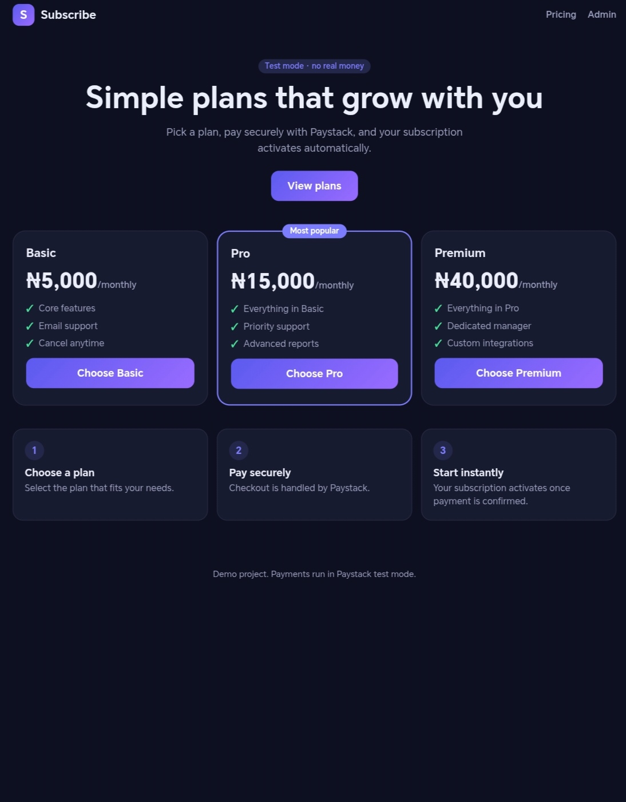
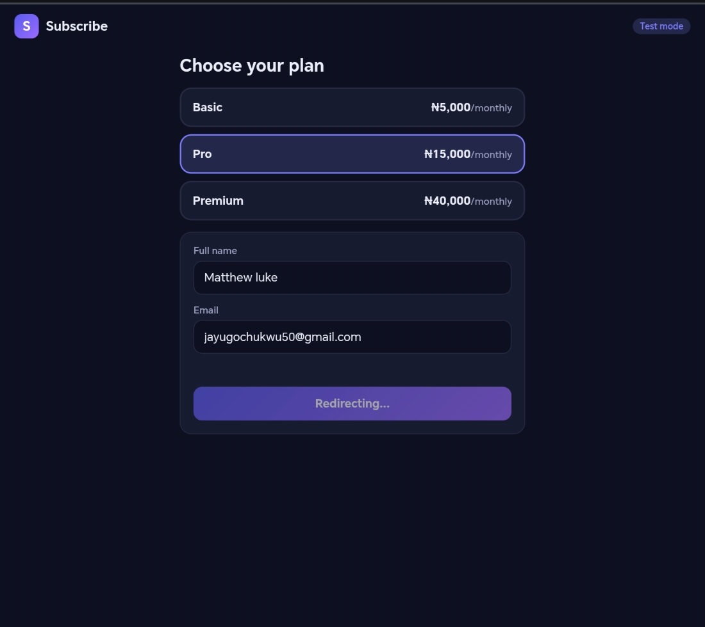
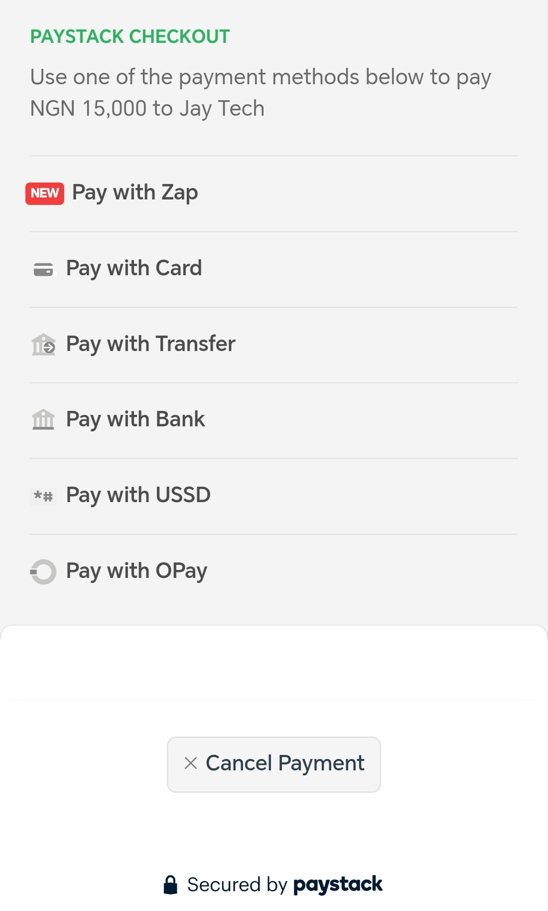
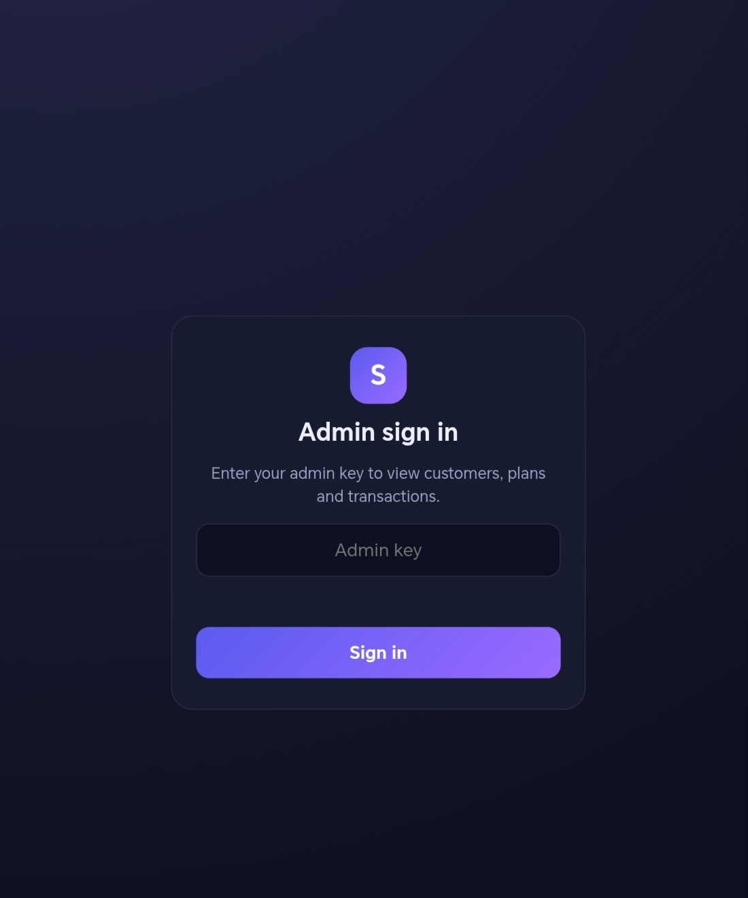
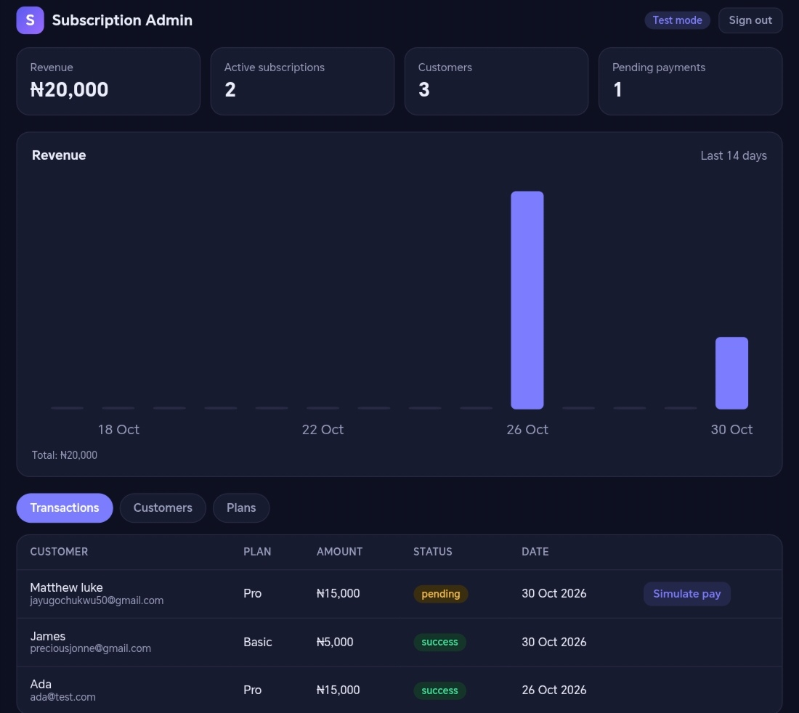

# Subscription Billing App

A subscription billing backend with Paystack test-mode payments, signed webhooks and an admin dashboard. Built with Node.js, Express and TypeScript.

> **Status:** Fully working in Paystack **test mode**. The webhook handler is implemented and tested with signed requests. Connecting it to Paystack's dashboard requires a public HTTPS URL, so that happens at deployment.

## Screenshots

| Pricing page | Plan selected | Checkout |
| --- | --- | --- |
| 



 | 



 | 



 |

| Admin sign in | Admin dashboard |
| --- | --- |
| 



 | 



 |

## Features

- Pricing page, checkout flow and Paystack hosted payment (test mode)
- Server-side payment verification: the amount and currency are checked against the database, never trusted from the browser
- Paystack webhook with HMAC SHA-512 signature verification
- Idempotent payment confirmation, so duplicate callbacks and webhooks cannot double count revenue
- Admin dashboard with stats, 14-day revenue chart, and customer, plan and transaction tables
- Admin sign-in screen backed by an API key
- Input validation with clear, field-level error messages
- Loading, empty and error states throughout the UI
- Light and dark themes, designed mobile-first
- Automated tests (18) using Node's built-in test runner and an in-memory database

## Tech stack

TypeScript, Node.js, Express, SQLite (`node:sqlite`), Zod, Helmet, express-rate-limit, Paystack API, vanilla HTML, CSS and JavaScript (the chart is plain SVG, no library).

## How a payment works

1. The customer chooses a plan on the pricing page and enters their details.
2. The server validates the input, creates a pending transaction with the price taken from the database, and initialises a Paystack transaction.
3. The customer pays on Paystack's hosted page.
4. Paystack redirects back to the callback route, and the server verifies the transaction with Paystack before marking it paid.
5. Paystack also sends a signed `charge.success` webhook, which confirms the same payment even if the customer closes the tab early. Repeat deliveries are harmless.

## Getting started

Requires **Node.js 22.5 or newer** (for the built-in SQLite module) and a free [Paystack](https://paystack.com) account in test mode.

```bash
git clone <your-repo-url>
cd subscription-app
npm install
cp .env.example .env
```

Edit `.env`:

| Variable | Purpose |
| --- | --- |
| `ADMIN_KEY` | Long random string used to sign in to the admin dashboard |
| `PAYSTACK_SECRET_KEY` | Your **test** secret key (starts with `sk_test_`) |
| `BASE_URL` | Optional. Public URL used for the Paystack callback (default: `http://localhost:3000`) |
| `PORT` | Optional. Defaults to 3000 |

Generate an admin key with:

```bash
node -e "console.log(require('crypto').randomBytes(16).toString('hex'))"
```

Start the server:

```bash
npm run dev
```

| Page | URL |
| --- | --- |
| Pricing | `http://localhost:3000/` |
| Checkout | `http://localhost:3000/checkout.html` |
| Admin | `http://localhost:3000/admin` |

Use only **test** keys. Paystack's test payment page lists test card details you can use.

## Running the tests

```bash
npm test
```

Tests run against an in-memory database with their own test keys, so real data and real keys are never used. They cover validation, duplicate handling, admin protection, the payment flow, webhook signature checks, amount mismatches and repeat deliveries.

## API overview

| Method | Route | Access | Purpose |
| --- | --- | --- | --- |
| GET | `/health` | Public | Health check |
| GET | `/api/plans` | Public | List plans |
| POST | `/api/customers` | Public | Create a customer |
| POST | `/api/subscriptions` | Public | Create a pending subscription and transaction |
| POST | `/api/payments/checkout` | Public | Start a Paystack payment |
| GET | `/api/payments/callback` | Public | Verify the payment when the customer returns |
| POST | `/webhooks/paystack` | Signed by Paystack | Receive payment events |
| GET | `/api/customers` | Admin | List customers |
| GET | `/api/admin/stats` | Admin | Revenue and subscription totals |
| GET | `/api/admin/revenue` | Admin | Revenue for the last 14 days |
| GET | `/api/admin/transactions` | Admin | List transactions |
| POST | `/api/dev/simulate-payment/:reference` | Admin, non-production | Simulate a payment for local testing |

Admin routes require an `x-admin-key` header.

## Security decisions

- **Prices come from the database**, so the browser cannot choose its own amount.
- **Payments are verified server-side** with Paystack, and amount and currency must match.
- **Webhook signatures** are checked over the raw request body, and requests with a missing or wrong signature are rejected with a 401.
- **Constant-time comparison** (`timingSafeEqual`) for both the webhook signature and the admin key.
- **Parameterised SQL queries** prevent SQL injection.
- **Validation before the database**, with request size limits and rate limiting on the API.
- **Internal errors are not exposed.** They are logged server-side and clients see a generic message.
- **Helmet** sets secure HTTP headers.
- **Secrets stay out of Git.** `.env` and the database are ignored, and money is stored as integer kobo to avoid rounding bugs.

## Project structure

```
src/
  app.ts            Express app and public routes
  server.ts         Starts the server
  db.ts             SQLite schema and seed plans
  middleware.ts     Validation, admin guard, error handling
  schemas.ts        Zod schemas
  subscriptions.ts  Subscription creation and idempotent payment confirmation
  paystack.ts       Paystack API client
  payments.ts       Checkout and callback routes
  webhooks.ts       Signed webhook handler
  routes.ts         Subscription and admin routes
public/             Pricing page, checkout, admin dashboard and chart
test/               Automated tests
docs/               Screenshots
```

## Limitations and roadmap

- [ ] Deploy to a public HTTPS URL and register the webhook in Paystack's dashboard
- [ ] Recurring billing and renewals (currently each plan is a one-time charge with an active status)
- [ ] Subscription cancellation and expiry
- [ ] Per-user admin accounts instead of a single shared key
- [ ] Switch from SQLite to a hosted database for production